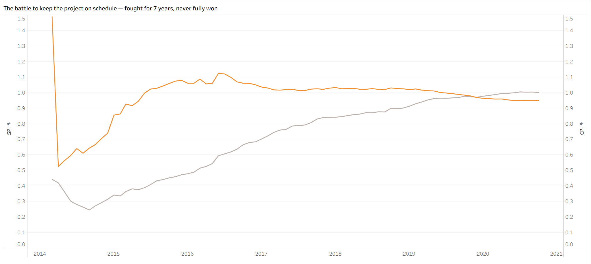
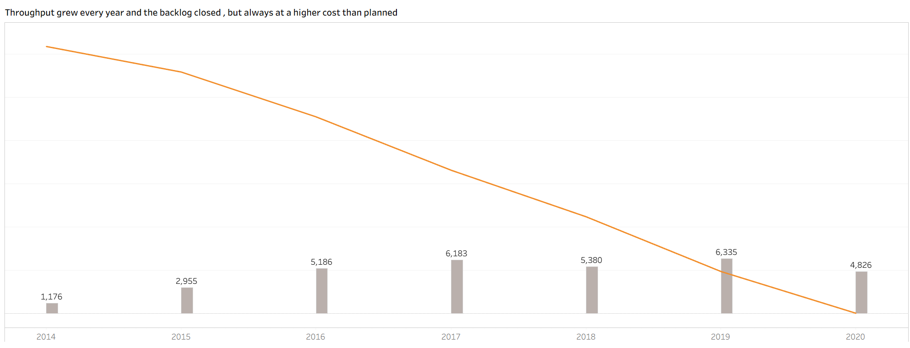
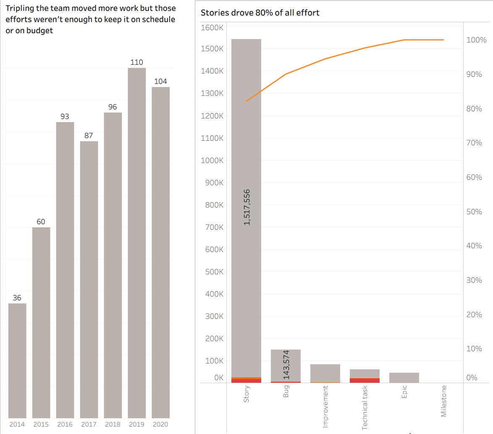
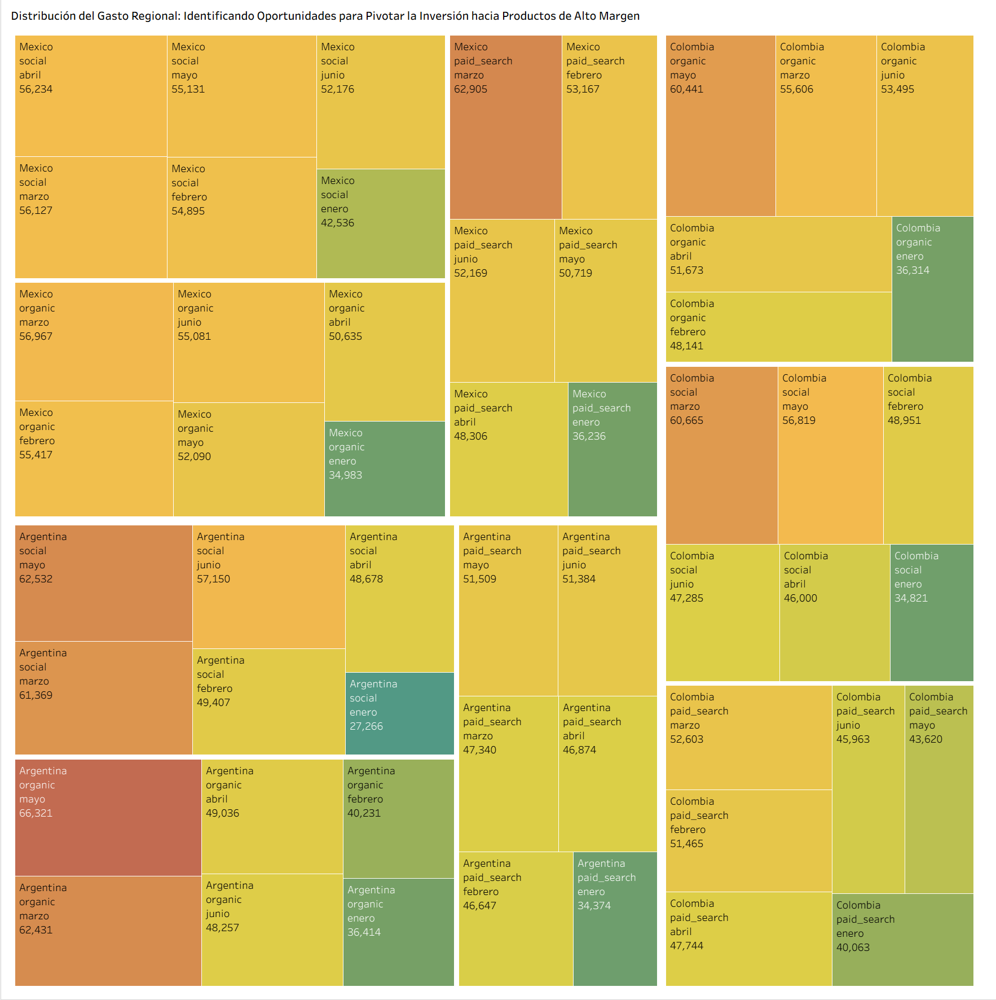
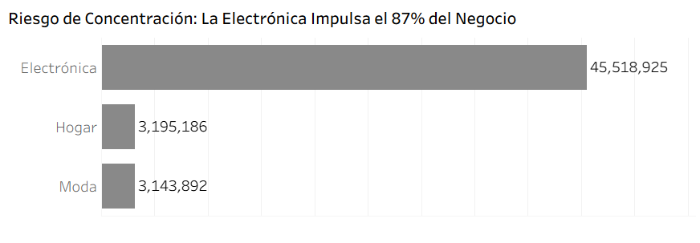
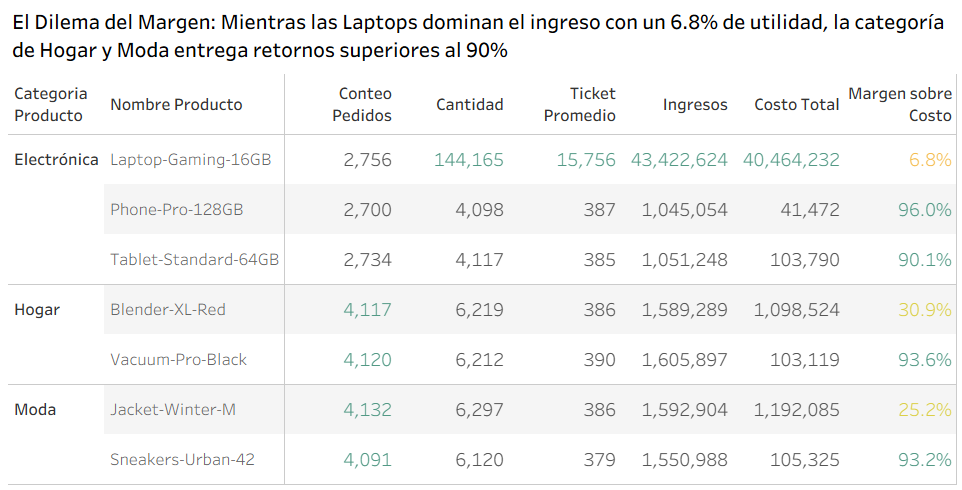

[English Version](/MicheleQuere.github.io/en/)

## ACERCA DE MÍ
Project Manager con una certificación de Data Analyst.
Mi enfoque no se limita a gestionar tareas; se trata de orquestar flujos de trabajo donde los datos dictan la estrategia y la tecnología potencia la experiencia.

[quere.michele@gmail.com](mailto:quere.michele@gmail.com) | +52 55 5072 8230 | 
[www.linkedin.com/in/michelequere](http://www.linkedin.com/in/michelequere) | México, CDMX

### Habilidades tecnológicas

- Análisis y gestión de Datos utilizando:
Google Sheets | SQL | Python
- Visualización de Datos usando:
Matplotlib |Seaborn | Tableau | PowerBI

### Habilidades Blandas

Análisis de datos | Resolución de problemas | Comunicación efectiva | Orientación a resultados | Atención al detalle

---

## Proyectos

## Análisis de Asignación de Recursos y Presupuesto en Tres Proyectos de TAWOS

Tomamos el dataset de Jira TAWOS, descargable aquí: https://github.com/SOLAR-group/TAWOS, y elegimos tres de sus proyectos documentados (Mule, Titanium Mobile Platform y Appcelerator Studio, 20,854 issues de 2004 a 2020) para analizar cómo se relaciona la mezcla de seniority de un equipo con lo que entrega, lo que cuesta y con qué frecuencia el trabajo regresa. TAWOS no tiene puestos, sueldos ni presupuestos, así que agregamos una capa sintética claramente identificada: el Enterprise HRA Allocation Dataset (https://www.kaggle.com/datasets/ziya07/enterprise-human-resource-allocation-dataset), asociado a los contribuyentes reales según su nivel de seniority. La tabla final tiene una fila por issue de Jira, además de tablas de sprints, presupuestos y costo mensual.

### Herramientas

Python | Pandas | SciPy | Simpful (lógica difusa) | MySQL en Docker | SQLAlchemy | Tableau

### Preguntas clave

- ¿Cuál de los tres proyectos tuvo el mejor desempeño y en qué medidas?
- ¿Una mayor proporción de Seniors aumenta el rendimiento de forma lineal, o importa más la composición del equipo?
- ¿Cuándo superó cada proyecto su presupuesto y cómo cambió su ritmo?
- ¿Qué tan concentrado está el esfuerzo en pocas personas y qué tan frágil es eso?
- ¿Existe un cuello de botella de revisión en los Seniors y por qué el trabajo termina tarde?

### Metodología

- Los datos se cargaron en MySQL 8.0 (Docker), se exploraron tabla por tabla y se estandarizaron (fechas, etiquetas, un solo vocabulario de niveles). El historial de story points se reconstruyó a partir del change log, porque la bandera propia de TAWOS "changed after estimation" detectó solo alrededor del 17% de las revisiones reales.
- Nulos: decidimos conservar todos los nulos y nunca eliminar filas en silencio. Cada uno recibió una decisión explícita. El 57.5% de los issues no tiene story points. Son en su mayoría trabajo reactivo de bugs y concentran el 51.8% del esfuerzo, por lo que se quedan en el costo pero no en el valor ganado (sin horas planeadas y sin story points imputados). Los 1,636 issues abiertos no tienen fecha de resolución, así que se excluyen de la serie mensual y de las gráficas por año, pero su costo permanece en los totales del proyecto. Los issues sin sprint (14,673) o sin fechas de sprint (277) se excluyen solo de las medidas basadas en sprints (EVM, retrasos), y la cobertura se reporta junto a cada resultado. 1,867 issues (9%, casi todos en Mule) no tienen responsable: para 263 se recuperó el responsable anterior desde el change log, y el resto se conservó como categoría propia y se valuó con la tarifa mediana del equipo núcleo. Nunca se imputa un nivel: los 1,959 issues sin responsable con nivel se etiquetan "No tier (assumed rate)". Solo se eliminaron columnas vacías o poco confiables (por ejemplo, Pull_Request_URL, 100% vacía).
- Los niveles de seniority (de Junior a Senior) se calcularon a partir de la actividad real (antigüedad, volumen de issues, story points, proporción de trabajo de alta prioridad) y se cortaron por percentiles del equipo núcleo (97 personas). Son relativos, no años de experiencia.
- Los 5,000 perfiles sintéticos de RH se redujeron a 902 empleados de tecnología y se calificaron con un sistema difuso (81 reglas, Mamdani). Cada uno de los 182 contribuyentes calificados recibió un empleado del mismo nivel (semilla 42), lo que definió su tarifa por hora. Las conclusiones son válidas solo a nivel de nivel de seniority, no de persona.
- Valores atípicos (outliers) en el esfuerzo real de TAWOS: 509 tickets (70 en Appcelerator, 257 en Mule, 182 en Titanium) tienen más de 30 días de esfuerzo registrado. Son solo entre el 1% y el 6% de los issues de cada proyecto, pero concentran el 51%, 69% y 80% del costo resuelto, y dos de los tres más grandes se cerraron sin corrección (Won't Do, Won't Fix). Por eso el campo se comporta como tiempo transcurrido y no como horas trabajadas: en estos tickets el esfuerzo es en mediana el 79% de toda la vida del ticket (9% en el resto), se correlaciona 0.39 con el tiempo que el ticket estuvo abierto y aproximadamente 0 con comentarios o reasignaciones. Primero decidimos conservarlos como la mejor aproximación disponible del esfuerzo, y cambiamos la decisión cuando apareció esta evidencia. Se limitaron a 720 h (30 días) por ticket, lo que afecta exactamente a los tickets marcados. Se compararon y descartaron dos alternativas: un tope en el percentil 99 de los tickets ordinarios (602 h) recortaba 81 tickets más, y 160 h habría recortado 2,001, incluidos muchos ordinarios. No se eliminó nada: los valores originales permanecen en el dataset, las versiones limitadas están en columnas separadas y cada outlier está marcado. El tope reduce el costo resuelto de $90.4 M a $40.6 M, y el costo total limitado es de alrededor de $41.0 M. El tope es un techo, no una corrección: los tickets limitados siguen contando 720 h cada uno (cerca de un tercio del total limitado), por lo que su esfuerzo real se desconoce. Los issues cerrados sin entrega (Won't Fix, Duplicate, Cannot Reproduce y similares, del 10% al 14% de los story points) salen del alcance en su fecha de cierre y no generan valor, pero sus horas permanecen en el costo. Los presupuestos son simulados (Mule 120% del costo, Titanium 85%, Appcelerator un monto anual fijo), por lo que los resultados de presupuesto son por diseño, no hallazgos. Lo que aporta información es la trayectoria.
- El EVM se construyó por sprint, con el alcance reconstruido a partir del change log. El PV es una línea recta en el tiempo, porque los datos no tienen fechas planeadas. El análisis de retrasos usa el 24% de los issues y el de horas planeadas vs reales, el 28%.
- Se crearon cinco dashboards en Tableau. Para el bus factor y la mentoría, Python es la fuente de verdad.

### Conclusiones y Recomendaciones

**Hallazgos**

Ningún proyecto gana en todas las medidas. Mule mantuvo su eficiencia de costo (CPI 0.97) y tiene la base de contribuyentes más amplia (23 personas para el 80% de las horas), pero tiene más trabajo tardío (34% de los issues entregados en sprints se resolvieron después de que terminó el sprint). Titanium tiene el menor retrabajo (5.7% de los issues resueltos se reabrieron), pero superó su presupuesto en agosto de 2018 y depende de cinco personas para el 80% de las horas. Appcelerator terminó con un CPI de 0.43 y el mayor retrabajo (25.5% reabiertos), también con cinco personas para el 80% de las horas.

El seniority no actúa de forma lineal. En 238 sprints, una línea recta casi no explica nada (R² 0.018), y el contexto del proyecto importa más que la simple cantidad de Seniors. En Appcelerator, más Seniors se asociaron con +32 puntos por persona; en Mule, con un rendimiento ligeramente menor (−8); y en Titanium, sin una tendencia clara. La proporción de Seniors promedió 74% en Appcelerator, 46% en Mule y 41% en Titanium.

La trayectoria del ritmo dice más que el SPI final. Appcelerator y Titanium arrancaron muy por delante de una línea de ritmo constante (SPI 3.4 y 2.8) y convergieron a 1.0, mientras que Mule arrancó atrasado (0.7 y 0.6) y llegó a un máximo de 1.4. Un SPI mayor a 1 no significa ir adelantado, porque el plan es una línea de ritmo constante y el alcance siguió creciendo después de que iniciaron los sprints (+45% Appcelerator, +49% Mule, +35% Titanium).

El esfuerzo depende de muy pocas personas en dos proyectos. La persona más ocupada de Appcelerator resolvió el 18% de los issues en 2011 y el 90% en 2016. Titanium estuvo entre 51% y 81% cada año desde 2012. Mule se mantuvo entre 10% y 29%.

No hay señales de un cuello de botella de revisión en los Seniors (mediana de revisión de 25.6 h en issues de Juniors vs 25.1 h en los de Seniors, correlación de rangos −0.03), pero los datos no indican quién revisó. Existe capacidad de mentoría (de 3 a 6 mentores por sprint), pero no hay evidencia de que algún Junior haya sido realmente mentoreado.

El trabajo tardío aumenta con el tiempo en todos los niveles. En Titanium se explica por sprints más cortos (de 11 a 13 días a 6 días en 2016, con el trabajo tardío pasando de 6–8% a 46–51%). En Mule subió de 19% (2014) a 59% (2018) y estos datos no lo explican.

**Recomendaciones**

- Registrar fechas planeadas e hitos en la herramienta de seguimiento. Sin ellos, el SPI solo puede medir el ritmo contra una línea constante, y un aumento del alcance de 35% a 49% dentro de los sprints no se puede separar de una entrega lenta. Los hitos crean puntos de control para revisar el CPI y el SPI antes de que las desviaciones se vuelvan crónicas.
- Tratar la dependencia de una o dos personas como un riesgo que hay que gestionar. Appcelerator y Titanium necesitaron solo cinco personas para el 80% de las horas, y en Appcelerator una persona resolvió hasta el 90% de los issues en un año. Planear capacitación cruzada y revisar el bus factor cada año.
- Vigilar el retrabajo por proyecto, no por nivel. El retrabajo difirió mucho más entre proyectos (25.5%, 9.8%, 5.7%) que entre niveles, así que los controles de calidad para el backlog de Appcelerator, con muchos bugs (58%), deberían ser el primer lugar donde mirar.
- Registrar los cambios de proceso junto al desempeño. Un cambio como sprints más cortos puede parecer una caída de desempeño. Hay que dejarlo documentado para leer los retrasos y el rendimiento en contexto.
- Registrar quién revisa y con quién colabora cada persona, y el contexto de proyecto de cada issue. Son los datos necesarios para probar la mentoría y los cuellos de botella de revisión de forma directa, en lugar de usar aproximaciones.

### Visualizaciones

Cómo evolucionaron sprint por sprint la eficiencia de costo (CPI en USD y en horas) y el ritmo del calendario (SPI) de cada proyecto, para que el lector vea la trayectoria y no solo el valor final.

Cómo se reparten las horas de esfuerzo de cada proyecto por tipo de issue, para mostrar cuánta capacidad se fue en trabajo reactivo de bugs.

Issues resueltos por sprint a lo largo del tiempo, sombreados según la proporción de Seniors, para mostrar la mezcla de equipo y el periodo de actividad de cada proyecto.

Prueba si una mayor proporción de Seniors se asocia con más puntos por persona, usando una curva ajustada y su rango para cada proyecto.

Cuántas personas se necesitaron para cubrir el 80% del trabajo cada año, como medida de la dependencia de pocas personas.

---

## Análisis de Desempeño Operativo en el proyecto Lsstcorp Data Management

Tomamos el dataset **tawos_test_clean.csv** descargable aquí : [https://www.kaggle.com/datasets/rachetkhanal/tawos-csv-clean?resource=download](https://www.kaggle.com/datasets/rachetkhanal/tawos-csv-clean?resource=download) para escojer uno de los proyectos documentados y hacer un análisis de rendimiento del proyecto elegido: Lsstcorp Data Management de 2014 a 2020. La tabla final contiene registros de Jira de dicho proyecto.

### Herramientas

Python | Pandas | Tableau

### Preguntas Clave

- ¿ Se tuvo éxito con la entrega del proyecto Lsstcorp Data Management?
- ¿Qué mejoras de gestión se implementaron para mantener el proyecto en el cronograma?
- ¿Los obstáculos principales en este proyecto radicaron en la capacidad y ejecución del equipo, o en deficiencias de planificación y gobernanza?

### Metodología

- Se exploraron los datos y se escogió el proyecto basado en la cantidad de entradas no nulas, es decir el proyecto que tenía el mayor número de registros completos
- Se estandarizaron fechas y se decidió rellenar los datos de Story Points faltantes con la mediana de los Story Points
- El SPI y CPI se calcularon con trabajo acumulado y las fechas de estimación para calcular el EV y PV. 16.8% de Fechas de estimación no estuvieron registradas y 22.1% de tiempo de esfuerzo real tampoco fueron registrados.
- Se crearon Dashboards de Overview y Detalle en Tableau para presentar conclusiones

### Conclusiones y recomendaciones

**Hallazgos:**

- **La gran batalla por el cronograma (SPI):** El proyecto arrancó con un fuerte retraso en 2014 (SPI de ~0.4), lo que sugiere que la planificación lineal inicial fue demasiado agresiva para la fase de arranque o que el equipo tardó en tomar ritmo. También pudo agrandarse el trabajo en los alcances del proyecto y las acumulaciones de Technical debt y bugs en el backlog. Sin embargo, el proyecto no se estancó: muestra una **recuperación anual constante y sostenida durante 7 años**, logrando acelerar el paso año con año hasta cerrar exactamente a tiempo en 2020 con un SPI perfecto de 1.0.
- **La paradoja de la eficiencia en costos (CPI):** Al contrario del análisis previo, el proyecto fue **altamente eficiente en costos durante la mayor parte de su ciclo de vida (2015-2018)**, manteniéndose con un CPI saludablemente por encima de 1.0 (con picos de hasta 1.15), cuando se triplicó el equipo. Esto demuestra que la ejecución técnica intermedia fue sumamente limpia. La pérdida de eficiencia (CPI < 1.0) ocurrió estrictamente en la recta final (2019-2020), cuando bajaron de nuevo los números de integrantes del equipo, arrastrando el acumulado histórico a un aceptable 0.95 al cierre.
- **El impacto real del escalamiento:** Triplicar el tamaño del equipo (de 36 integrantes en 2014 a 110 en 2019) **sí funcionó para rescatar el cronograma**. El incremento de personal coincide directamente con la aceleración del SPI. Sin embargo, hacia los últimos dos años se observa un efecto de los rendimientos decrecientes: el costo de coordinación y la complejidad del equipo penalizaron el CPI, haciéndolo caer por debajo de 1.0 al final.

**Recomendaciones:**

- Se sugiere definir hitos formales desde el inicio del proyecto aunque estos varien a lo largo del ciclo de vida del proyecto, no hasta el año 5. Los hitos obligan a tomar decisiones de gobernanza, crean puntos de control naturales para revisar las desviaciones de CPI y SPI, y le dan al liderazgo momentos estructurados para intervenir antes de que el bajo desempeño se vuelva crónico. Un proyecto que dura 7 años sin hitos no tiene un sistema de alerta temprana. Tal vez el error sólo es de rigor de documentación en Jira.
- Tolerancia implícita a desviaciones crónicas. Mantener los índices de desempeño (CPI/SPI) apenas por debajo de 1.0 de manera sostenida oculta ineficiencias en la planeación y genera pérdidas financieras acumuladas severas, aun cuando la ejecución técnica sea sólida. Implementar un protocolo de escalamiento automático ante variaciones lineales estables. Se sugiere un diagnóstico temprano enfocado en la calibración de las estimaciones y la revisión de la gobernanza del alcance, evitando asumir que la estabilidad del indicador exime al proyecto de una revisión de causa raíz.
- Más rigor en la documentación de Jira (u otro software de manejo de proyectos) es muy útil para analizar los procesos y ver dónde se sale de control el proyecto.

### Visualizaciones

Gráfico de líneas para visualizar la evolución del SPI y CPI durante la duración del proyecto

Burndown para revisar el número de story points completados por año (con granularidad dinámica para filtrar por año

Diagramas de Pareto y de Barras para visualizar el esfuerzo total en horas por tipo de ticket y el crecimiento del equipo por año

Ver en Tableau Public:

[repositorio Tableau lsstcorp DM](https://public.tableau.com/views/DashboardLsst/Overview?:language=es-ES&publish=yes&:sid=&:redirect=auth&:display_count=n&:origin=viz_share_link)

Ver el repositorio completo en github:

[repositorio completo lsstcorp DM](https://github.com/MicheleQGF/lsstcorp_DM-TAWOS_test)

---

## Proyecto RappiPlus

El objetivo de este proyecto es evaluar el desempeño del servicio **RappiPlus** para apoyar **decisiones de negocio basadas en datos**.

Se trabajan con múltiples datasets del negocio:

- **rappiplus_orders_raw.csv:** información de pedidos, precios, descuentos y revenue
- **rappiplus_catalog.csv:** costos de productos, categorías y proveedores
- **rappiplus_marketing_spend.csv:** inversión en marketing por canal y país
- **events / users / user_activity (SQL):** comportamiento del usuario dentro de la plataforma
- **experiment_checkout_ui.csv:** resultados de un experimento A/B en el checkout

#### Herramientas

Python | Pandas | SQL | Tableau

### Preguntas Clave

- ¿Los usuarios realmente compran más?
- ¿El modelo está generando ganancias?
- ¿Se están perdiendo oportunidades en el proceso de compra?

### Metodología

- Se limpiaron y estandarizaron los datos, eliminando inconsistencias y verificando la ausencia de duplicados y valores faltantes.
- Se hizo un análisis de la rentabilidad del negocio: Se calcularon ingresos totales, costo total, inversión en Marketing y margen sobre costos y marketing. También se calculó el ticket promedio por orden, la cantidad promedio de productos por orden, el gasto en marketing por canal y se encontró el producto más vendido
- Se construyó un funnel de conversión y se hizo un análisis de la conversión entre cada paso para encontrar en qué etapa se pierden más usuarios. Posteriormente se realizó la evaluación de la retención por cohortes.
- Se analizó mediante una prueba Chi-cuadrado si había o no diferencia entre las dos variantes del producto.

### Conclusiones y recomendaciones

#### Hallazgos:

- **Argentina es el motor de rentabilidad:** Aunque vende casi lo mismo que México ($20.7M vs $19.7M), **Argentina entrega el 76% de la utilidad total del negocio** ($4.5M) con un espectacular margen del **21.73%**.
- **Ineficiencia táctica en México:** México es el país donde más dinero se gasta en Marketing ($988K), pero es el menos rentable de la región, aportando apenas un **3.27% de margen** ($645K de utilidad). Estamos quemando el presupuesto de adquisición en el mercado que menos retornos genera.
- **Dependencia extrema de un producto de bajo margen:** La *Laptop-Gaming-16GB* es un gigante que sostiene el **83.7% de los ingresos totales** de la operación ($43.4M de los $51.8M totales). El problema es que su margen es sumamente castigado (**6.81%**). Si el proveedor de laptops falla o cambia los precios, el negocio completo entra en pérdida.
- **Joyas ocultas sin volumen:** Los teléfonos, aspiradoras y tablets (*Phone-Pro, Vacuum-Pro, Tablet-Standard*) registran márgenes de ganancia brutales de **entre el 90% y el 96%**, pero sus volúmenes de venta son insignificantes en comparación con la laptop
- **El muro del Checkout:** El flujo de navegación es impecable: más del 90% de los usuarios que interactúan añaden productos y avanzan con una intención de compra altísima. Sin embargo, **el mayor cuello de botella es el abandono del 13% en `add_payment_info`**. Los usuarios quieren el producto, pero se echan para atrás cuando la plataforma les pide los datos de pago.
- **Retención de acero con techo de cristal:** Una retención que se congela de forma plana entre el 40% y 43% desde la semana 1 hasta la semana 4 demuestra que el producto tiene un *Product-Market Fit* muy sólido entre sus usuarios recurrentes. Sin embargo, está estancada. Las nuevas cohortes no están incrementando su compromiso a lo largo del tiempo, evidenciando un onboarding plano.
- **A/B Testing, un cambio irrelevante:** Con un p-value > 0.05, la variante de Tratamiento (16.3% de conversión) no demostró superioridad estadística real sobre el Control (15.7%). La muestra de ~10,000 usuarios combinados confirma que el rediseño o cambio evaluado no mueve la aguja del negocio.

#### recomendaciones:

- Reducir de inmediato el gasto de marketing en México (frenar la adquisición ineficiente) y reasignar esos fondos a **Argentina** para potenciar el mercado de alto margen (21.73%), y a **Colombia** para incentivar el crecimiento de su volumen.
- Recomendamos impulsar productos como el Phone-Pro-128GB (96% de margen) y la Vacuum-Pro-Black (94% de margen). Actualmente tienen un volumen de órdenes saludable pero un impacto mínimo en el ingreso total debido a su bajo precio o menor rotación comparada con las laptops.
- Priorizar los esfuerzos para resolver el drop-off del 13% en la pantalla de pagos. Se deben auditar las tasas de rechazo bancario de tarjetas de débito/crédito, simplificar los campos del formulario y habilitar métodos de pago alternativos locales
- Reenfocar el presupuesto de campañas de retargeting genéricas a un sistema de **recompensas e incentivos dinámicos**. Como la retención se aplana desde la semana 1, se sugiere otorgar beneficios/descuentos crecientes condicionados al uso consecutivo
- No se recomienda hacer el roll-out de la variante de tratamiento.

### Visualizaciones

Visualización diseñada para auditar la productividad del capital. El gráfico demuestra la sobredimensión del gasto en México (focalizado en *Social* y *Paid Search*) frente a un retorno de facturación que no justifica dicha proporcionalidad respecto a Argentina. Sirve como evidencia analítica irreversible para dar cumplimiento a la directriz de optimización: contraer el presupuesto ineficiente e inyectar liquidez en la plaza de mayor rendimiento.

Módulo analítico diseñado para evaluar la salud de la mezcla de productos. Los datos demuestran que el volumen de facturación actual es frágil: el 87% de los ingresos está concentrado en la categoría de Electrónica, la cual está severamente impactada por el bajo margen operativo de su producto principal, la *Laptop-Gaming* (6.8%). Esta sección sirve como evidencia analítica irreversible para sustentar un viraje comercial: es prioritario desacelerar la dependencia de la línea líder y diseñar campañas de posicionamiento para los productos de Hogar y Moda que ofrecen retornos superiores al 90% sobre el costo.

link a Tableau Public:

[Repositorio Tableau Rappiplus](https://public.tableau.com/views/Sprint12_ProyectoFinal/DashboardOverview?:language=es-ES&:sid=&:redirect=auth&:display_count=n&:origin=viz_share_link)

ver repositorio completo:

[repositorio completo Rappiplus](https://github.com/MicheleQGF/ProyectoRappiPlus)

---

## Estrategia comercial de Andes Capital Real Estate

La empresa gestiona la venta de diferentes tipos de propiedades a través de distintos canales de venta y segmentos de clientes. La información existe a nivel transaccional, pero el cliente busca una visión analítica clara del negocio. Se crea un dashboard interactivo en Power BI para lograrlo con los datasets siguientes:
**hecho_ventas_propiedades.csv**: tabla de hechos con información de ventas
**dim_clientes.csv**: tabla con información de segmentación por cliente
**dim_propiedades.csv**: tabla con información sobre tipo de propiedades, categoría, tamaño y número de habitaciones

### Herramientas

Power BI

### Metodología

- Con ayuda de Power Query checamos duplicados y valores nulos. Se estandarizaron los tipos de datos.
- Se creó una tabla dim_fecha para poder crear medidas de inteligencia de tiempo
- Se conectaron las 3 tablas gracias a id_propiedad e id_cliente
- Se crean medidas con contexto de filtro y medidas para análisis de cohortes.
- Se realizan Dashboard de Overview, Análisis Comercial, Detalle Canal de Venta, Detalle Tipo de Propiedad, Detalle Segmento Comprador, Tamaño y Número de habitaciones, Cohorte Mes Venta y Cohorte Retención

### Preguntas Clave:

- ¿Cuál es el **ingreso total** generado por las ventas de propiedades?
- ¿Qué **tipo de propiedad genera más ingresos**?
- ¿Qué **segmentos de clientes compran más**?
- ¿Cómo evolucionan las **ventas en el tiempo**?
- ¿El negocio está **creciendo año contra año**?
- ¿Los clientes **vuelven a comprar después de su primera compra**?

### Hallazgos clave

- El ingreso total del periodo 2023-2024 fue de 6,012.5 Millones generado por 8500 ventas.
- El tipo de propiedad que genera mayores ingresos son las casas, 1,147 Millones en 2024
- La Ciudad de México es el motor principal de ingresos, 1,704 Millones en 2024
- El canal de Corredores sostiene la estructura comercial con el 72.8% de la facturación.
- El Producto Estrella para la cantidad de ventas son las unidades de 100.40 m² con 2 y 3 habitaciones son el estándar de mayor rotación y liquidez en el inventario actual.
- Hay un margen del 3% estable sobre las comisiones.

**Métricas principales**

- Ingreso Total: 6,012.5 Millones durante 2023 y 2024
- Cantidad de Ventas: 8500 ventas durante 2023 y 2024
- Ticket Promedio: 707,350 durante 2023 y 2024
- Comisión Total: 200,630 durante 2023 y 2024

**Insights accionables**

- Existe una dependencia crítica del comprador de "Primera vez", que representa el 62.9% de los ingresos pero tiene más recurrencia sólo en las propiedades Comerciales y Casas.
- Existe una estacionalidad marcada: Las ventas se concentran peligrosamente en Otoño y Primavera, sufriendo caídas de hasta el 36% durante el invierno y el verano. Esto coincide con el cierre de ciclos fiscales y el pago de bonos anuales o utilidades en ambas regiones para
el primer periodo y como hipótesis, el volumen masivo de transacciones de departamentos en Otoño (835 ventas) sugiere que las familias buscan asegurar su vivienda antes de las festividades de diciembre.
- El segmento de clientes de primera vez concentra la mayor parte del ingreso, pero los Inversionistas y Alto Patrimonio son más recurrentes.
- Los clientes adquiridos en las cohortes de 2023 en los meses de Febrero, Marzo y Abril muestran mayor recurrencia.
- Las ventas muestran un crecimiento de 11.1% YoY. Aunque ese crecimiento se va ralentizando puesto que la línea de tendencia del MoM va a la baja.
- La retención de clientes aparece más en el Canal Directo. También existe retención en los clientes inversionistas que compran casas y propiedades de índole comercial. Es decir se ve retención de clientes en propiedades de valor Alto.

### Recomendaciones estratégicas

- Se sugiere **Mantener la Escala en el canal de Corredor:** Es el motor de alta rotación. Se usa para vaciar rápido el inventario estándar y mantener el flujo de caja constante, este sería continuar con la captación de departamentos de menos de 100 m2 de 2 y 3 recámaras de primera vez.  Así mismo, hay que **Impulsar la Rentabilidad en el canal directo:** Es el canal exclusivo para el "Programa Premium". Al no pagar comisiones externas, protege el margen del 3% y captura tickets más altos libres de competencia masiva.
- El segundo escenario interesante son las unidades de más de 200m², están libres de la competencia del comprador masivo de "Primera vez", siendo un territorio exclusivo para Inversionistas, el cual creció $128 millones y con un ticket promedio mayor, sobre todo las de tipo Comercial. Se necesita una diversificación dinámica del portafolio para captar este tipo de propiedades e incrementar la cartera de este tipo de compradores.
- Implementar un Programa de Lealtad Premium, es decir un esquema de beneficios para "Inversionistas Frecuentes" basado en el comportamiento observado en las cohortes que compran propiedades menores a los 100 m2, incentivando la compra de la segunda y tercera unidad. Este plan también buscaría incentivar cohortes más recientes (2024) a regresar a comprar.
- Este programa de Lealtad Premium podría ofrecerse más agresivamente durante verano e invierno con vistas a estabilizar el decrecimiento estacional durante estas épocas del año.

### Visualizaciones

A continuación un video demostrativo del dashboard interactivo creado en PowerBI:
<video src="assets/Andescapvideo.mp4" controls width="100%" poster="assets/2026-05-27 10_39_55-Proyecto10_MicheleQuere.png"></video>
